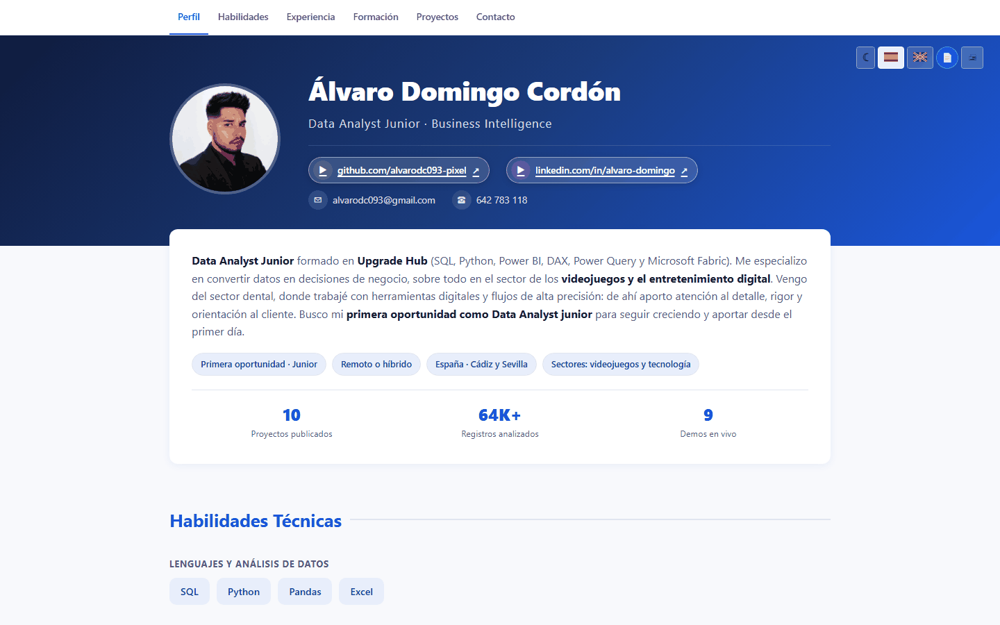

# Álvaro Domingo Cordón — Portafolio

**CV y portafolio web de Álvaro Domingo Cordón, Data Analyst Junior.**

[](https://alvarodc093-pixel.github.io/alvarodc093.github.io/)  



## En resumen

- **Qué es:** una sola página con perfil, experiencia, formación, habilidades y proyectos, cada uno con su demo y su repositorio.
- **Detalles:** español e inglés, modo oscuro, versión imprimible y CV en PDF descargable.

## Contenido

- Perfil, experiencia, formación, habilidades e idiomas.
- Proyectos destacados, cada uno con su demo y su repositorio, y una lista de los demás repositorios públicos que se carga desde la API de GitHub.
- CV en PDF descargable y versión imprimible de la propia página.

## Detalles técnicos

- Un único `index.html` con HTML, CSS y JavaScript sin dependencias ni build.
- Español e inglés, modo oscuro (respeta la preferencia del sistema) y ambas preferencias guardadas en el navegador.
- Navegación fija con la sección activa resaltada, enlace para saltar al contenido, soporte de teclado y de `prefers-reduced-motion`.
- Metadatos para buscadores y redes sociales (Open Graph y datos estructurados `Person`).
- Página 404 propia y una pequeña terminal oculta en el pie (`>_`).

## Estructura

```text
├── index.html               # Toda la web
├── 404.html                 # Página de error
├── profile.jpg              # Foto
└── CV_Alvaro_Domingo.pdf    # CV descargable
```

GitHub Pages publica la rama `main` tal cual.

## Contacto

[LinkedIn](https://www.linkedin.com/in/alvaro-domingo/) · [GitHub](https://github.com/alvarodc093-pixel) · alvarodc093@gmail.com
